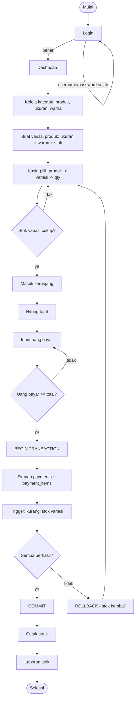
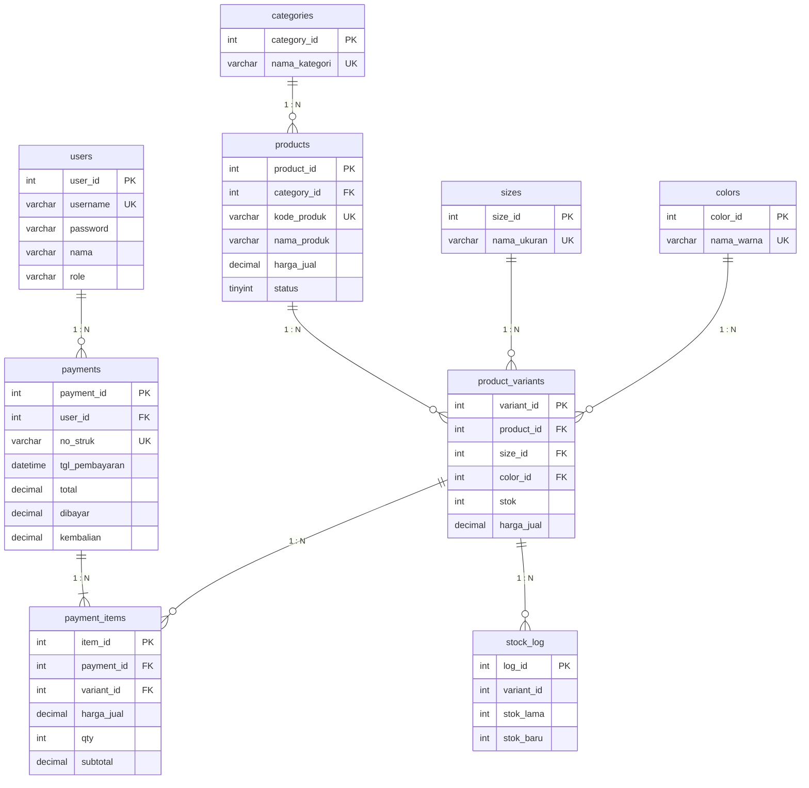

# Dokumentasi Program — Toko Fashion "StyleHub"

Teknologi: HTML, CSS, PHP (PDO), MySQL/MariaDB, VS Code + server lokal (XAMPP/Laragon).

## 1. Analisis kebutuhan (ringkas)

| Kebutuhan dari soal | Diwujudkan di |
|---|---|
| Login admin/kasir | `login.php`, `logout.php`, tabel `users`, hash password |
| Kategori | `kategori.php`, tabel `categories` |
| Produk (kode, nama, kategori, harga) | `produk.php`, tabel `products` |
| Variasi produk (ukuran, warna, stok) | `variasi.php`, `ukuran_warna.php`, tabel `product_variants`, `sizes`, `colors` |
| Pembayaran kasir (keranjang, uang bayar, kembalian) | `pembayaran.php`, tabel `payments`, `payment_items` |
| Stok per variasi | trigger + `laporan_stok.php` |
| Struk (cetak) | `struk.php` (tombol Cetak / Ctrl+P) |
| Laporan stok | `laporan_stok.php` |

## 2. Struktur folder

```
stylehub/
├── database.sql            ← seluruh SQL: tabel, function, view, trigger, data uji
├── index.php  login.php  logout.php  dashboard.php
├── kategori.php  ukuran_warna.php  produk.php  variasi.php  users.php
├── pembayaran.php  struk.php
├── laporan_stok.php
├── config/database.php     ← koneksi PDO
├── includes/               ← functions.php (fungsi bantu), header.php, footer.php (template)
├── assets/css/style.css    ← tampilan (gaya sama dengan website portofolio)
├── tests/test_database.sql ← skrip uji database
└── docs/DOKUMENTASI.md     ← file ini
```

## 3. Flowchart alur utama



## 4. ERD

Tabel: `users`, `categories`, `products`, `sizes`, `colors`, `product_variants`, `payments`, `payment_items`, dan `stock_log`.



## 5. Objek SQL yang dinilai

| Objek | Nama | Fungsi |
|---|---|---|
| Function | `fn_status_stok(stok)` | mengembalikan AMAN / RESTOK (≤ 5) / HABIS |
| Function | `fn_no_struk()` | membuat nomor struk `STR-YYYYMMDD-0001` |
| View | `v_variants` | JOIN produk + kategori + ukuran + warna + stok |
| Trigger | `trg_payment_items_bi` | menolak qty > stok (SIGNAL error) |
| Trigger | `trg_payment_items_ai` | mengurangi stok variasi otomatis |
| Trigger | `trg_variants_au` | mencatat perubahan stok ke `stock_log` |
| Transaksi | `pembayaran.php` | `beginTransaction()` → `commit()` / `rollBack()` |

## 6. Keamanan yang diterapkan

- **Prepared statement** (PDO) pada semua query yang memakai input pengguna → mencegah SQL injection.
- **Validasi input** di PHP (angka, panjang, nilai negatif) dan **CHECK constraint** di database.
- **Password** disimpan dengan `password_hash()`, dicek dengan `password_verify()`.
- **Hak akses**: admin penuh; kasir: pembayaran, struk, lihat produk, dan laporan stok.
- `session_regenerate_id()` setelah login.
- Semua teks yang ditampilkan melewati fungsi `e()` (`htmlspecialchars`) → mencegah XSS.

## 7. Hasil pengujian (isi kolom "Hasil" saat Anda menguji)

Cara uji: lakukan di aplikasi atau jalankan `tests/test_database.sql`. Isi kolom terakhir dengan **Berhasil / Gagal**
dan lampirkan screenshot.

| No | Skenario uji | Hasil yang diharapkan | Cara menguji | Hasil |
|---|---|---|---|---|
| 1 | Kombinasi produk + ukuran + warna ganda | Sistem menolak | Menu *Variasi & Stok* → tambah variasi yang sama persis dengan yang sudah ada | |
| 2 | Stok rendah | Variasi ditandai restok | *Laporan Stok* → badge RESTOK | |
| 3 | Perubahan stok tercatat | Baris baru di `stock_log` | `tests/test_database.sql` (UJI 3) | |
| 4 | Stok variasi kurang | Pembayaran ditolak | Kasir: qty melebihi stok (mis. 99) | |
| 5 | Uang bayar kurang | Pembayaran ditolak | Kasir: bayar < total | |
| 6 | Pembayaran multi-item | Semua detail tersimpan | Kasir: 3 item berbeda, cek struk | |
| 7 | Pembayaran sukses | Stok variasi berkurang | Bandingkan stok sebelum/sesudah di *Laporan Stok* | |
| 8 | Kegagalan simpan | Rollback mengembalikan stok | `tests/test_database.sql` (UJI 4) | |
| 9 | Struk | Tampilan siap cetak | Buka struk → Cetak / Ctrl+P | |
